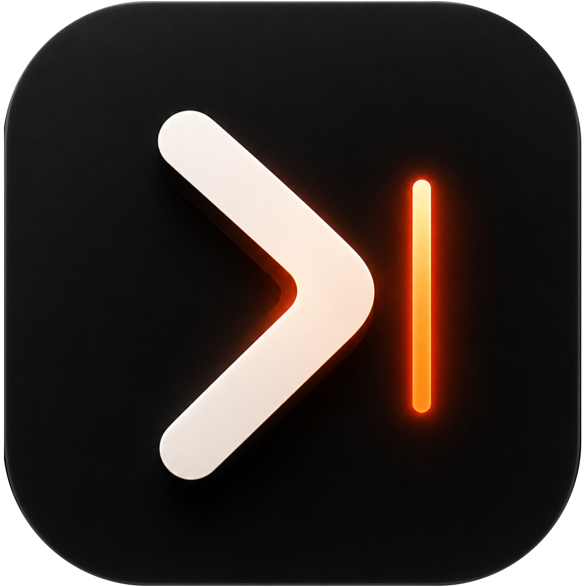
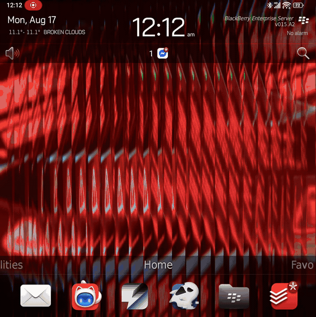
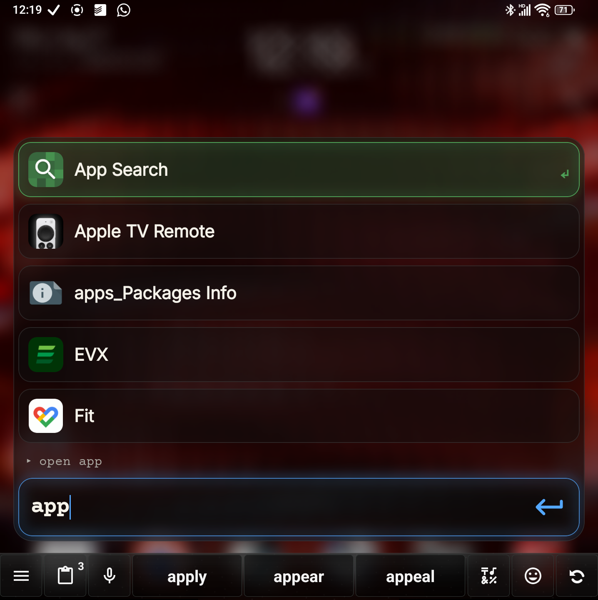
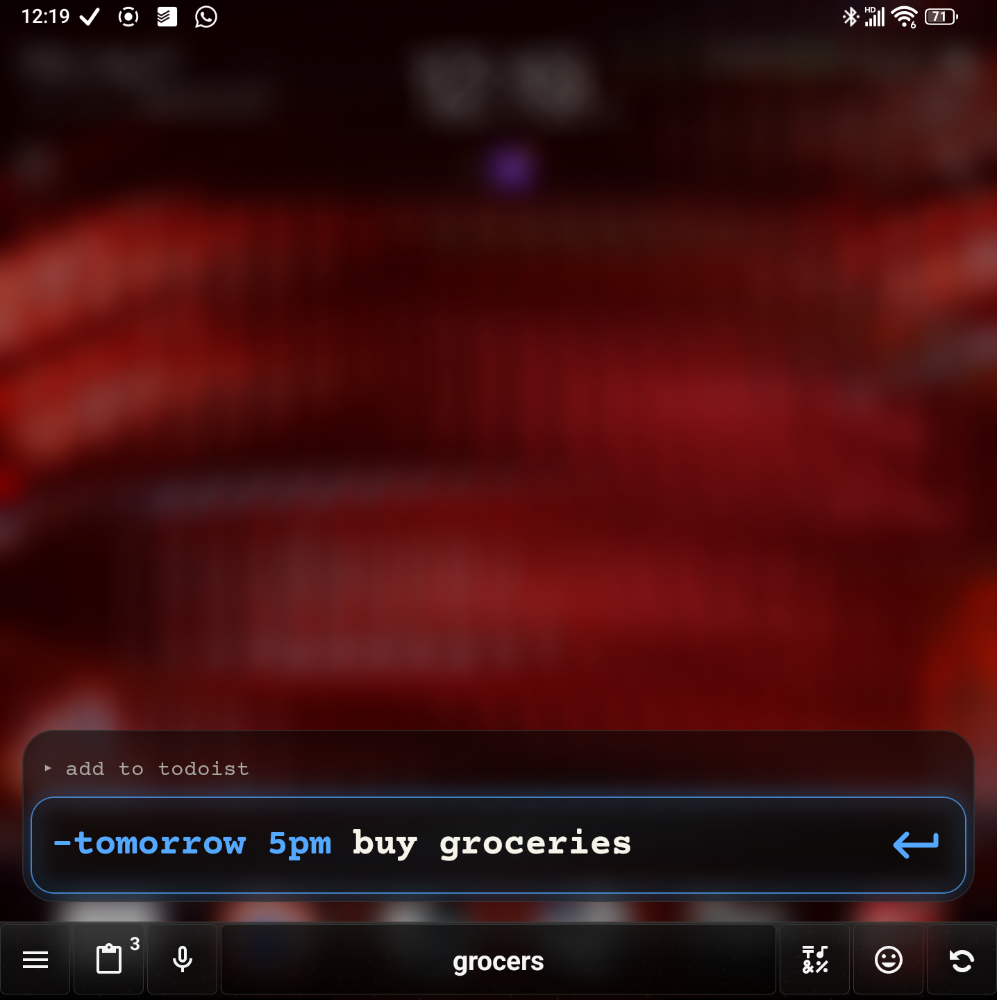
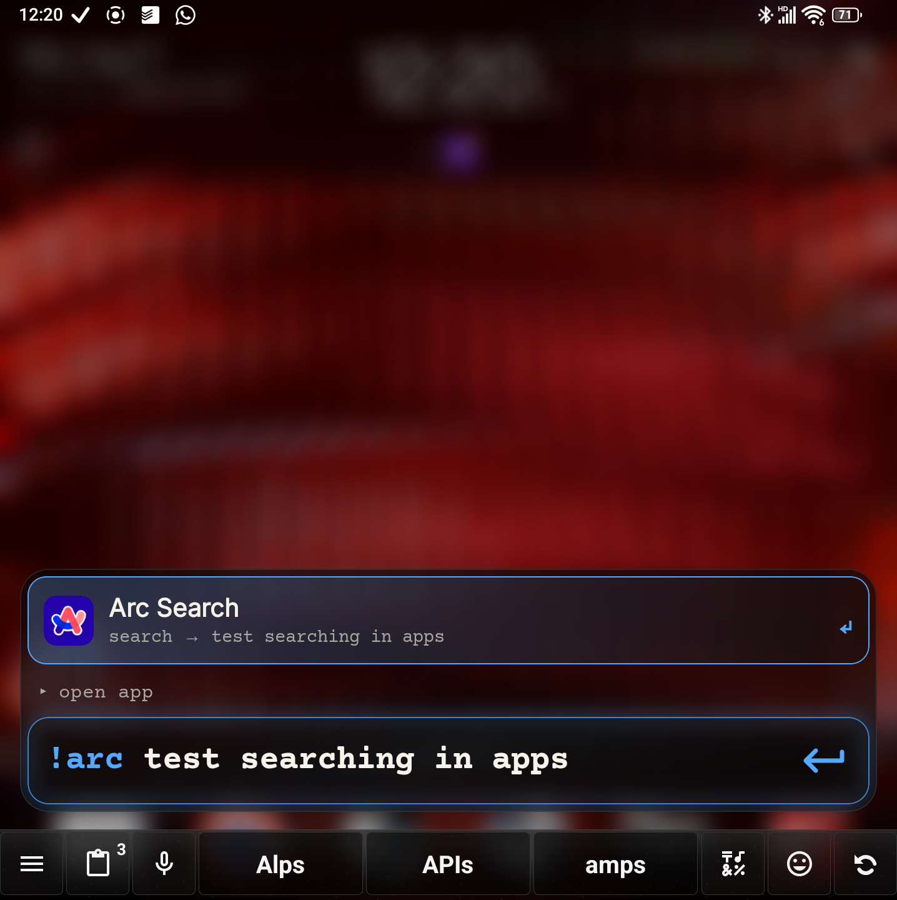
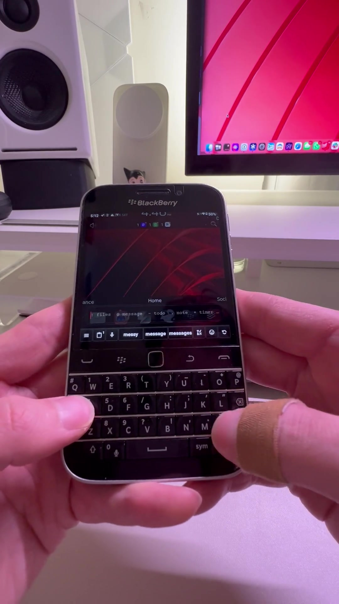

<p align="center">
  
</p>

<h1 align="center">Houston</h1>

<p align="center">
  A fast, keyboard-first command bar for Android.
</p>

> [!IMPORTANT]
> Houston is alpha software. Features may change, and some integrations depend on the Android version, device firmware, launcher, keyboard, and installed apps.

## What it does

Houston puts common Android actions behind one searchable overlay. Open the bar from a hardware key, launcher gesture, shortcut, or optional home-screen typing, then type what you want to do.

To open the touch search panel from any app, go to **Houston Settings → setup → Swipe to open Houston**, allow display over other apps, and turn on **Show swipe handle**. Swipe the slim handle inward (or tap it) to open search. Drag it up or down to reposition it, or use the **Right edge** switch to change sides.

The main Houston app icon opens Settings; the edge handle opens the search panel. Search results scroll independently of the keyboard. Use Up and Down to select a result, Enter to open it, or number keys 1–0 to activate the corresponding first ten results immediately. In a submenu, Backspace returns to the main search. The panel includes recent apps, screenshot browsing with tap-to-copy, and music playback controls. Screenshot browsing asks for photo access.

- Search installed apps and launcher shortcuts.
- Switch between recent apps with previews, filtering, keyboard navigation, and optional hold-to-switch shortcuts.
- Control accessible on-screen actions with compact keyboard hints and control search.
- Add Todoist tasks with natural-language date and time recognition.
- Browse Todoist Tasks, Upcoming, and Calendar views from the command bar.
- Search files and folders, with optional previews and sorting.
- Start timers, calculate expressions, and convert common units.
- Search contacts for calls and messages.
- Open configurable searches in Maps, YouTube, Spotify, Reddit, Play Store, and other apps.
- Search common Android Settings destinations through a configurable alias.
- Discover configured search and Tasker aliases directly inside the command bar.
- Run selected Tasker tasks.
- Ask Gemini in the overlay or continue a query in ChatGPT.
- Organise SMS contacts and saved messaging routes through Houston Contacts.
- Trigger supported audio, display, media, battery, and device Quick Controls.
- Customise accent colour, blur, glow, app-result animation, and interface sounds.

Houston is designed for speed and physical-keyboard devices first. It also works on conventional Android phones and can be operated by touch, but its shortest workflows are built around typing and keyboard navigation.

## Why Houston exists

Houston brings fast, keyboard-driven Android actions into one open-source app. Device reports, ideas, fixes, and feedback help improve it across different phones and workflows.

## See Houston in action

<p align="center">
  
  <br>
  <sub>Fast app search from a physical keyboard.</sub>
</p>

<table>
  <tr>
    <td align="center"><br><sub>Fast app search</sub></td>
    <td align="center"><br><sub>Recognised Todoist dates and times</sub></td>
  </tr>
  <tr>
    <td align="center"><br><sub>Configurable app aliases</sub></td>
    <td align="center"><br><sub>Recognised Todoist dates and times</sub></td>
  </tr>
</table>

<p align="center">
  
  <br>
  <sub>Houston on a physical-keyboard phone.</sub>
</p>

## Tested devices

Most development and testing has been done on:

- Unihertz Titan 2
- Zinwa Q25

Houston should work on other Android phones, including other keyboard phones, but hardware-key handling and background-launch behaviour vary between manufacturers. If you test another device, please [open a compatibility report](../../issues/new?template=bug_report.yml) with the model, Android version, keyboard, launcher, and what worked or failed.

## Tested integrations

The first alpha has been developed and personally tested primarily with:

- **Todoist** for tasks
- **Google Calendar** for calendar events
- The device's **default Clock app** for timers
- **Pastiera Enhanced** as the physical-keyboard input method
- **Solid Explorer** for file and folder results
- **Gemini API** for in-bar AI and **ChatGPT** for app hand-off
- **WhatsApp** and **Facebook Messenger** for supported notification replies and messaging workflows

Other apps may work when they expose compatible Android intents, shortcuts, or notification actions, but they have not received the same level of testing yet.

## Install and set up

Build the APK from this checkout with `./gradlew :app:assembleDebug`.

> [!WARNING]
> **Play Protect may warn that Houston is unknown or block the installation.** Houston is currently distributed directly through GitHub rather than Google Play, so new releases do not yet have Play Store reputation. Houston also offers optional Accessibility, contact, SMS, and file features, which Android correctly treats as sensitive. These permissions are requested only for the related features and are explained in [PRIVACY.md](PRIVACY.md).
>
> Install only a build from a source you trust. Do not disable Play Protect globally.

1. Build or obtain a trusted APK.
2. Allow installation from the app you used to download it, then install Houston.
3. Open **Houston Settings**.
4. Configure only the permissions and integrations you intend to use.
5. Add **Houston Bar** to a hardware key, launcher gesture, or automation app.

Houston requires Android 10 or newer.

Android may block Accessibility for manually installed apps until **Allow restricted settings** is enabled from Houston’s Android app-info page. Houston Settings provides direct links to both app info and Accessibility.

See the [complete setup guide](docs/SETUP.md) for notification access, home typing, files, contacts, Todoist, Gemini, Tasker, and keyboard shortcuts.

## Default commands

| Input | Action |
| --- | --- |
| normal text | Search installed apps |
| `Space` | Search files and folders |
| `@` | Message a contact |
| `#` | Call a contact |
| `-` | Add a task |
| `!` | Create a note |
| `*` | Create a calendar event |
| `+` | Start a timer |
| `,` | Calculate or convert units |
| `/` | Search the web |
| `?` | Ask Gemini in Houston |
| `??` | Continue in ChatGPT |

The note and file triggers are configurable. Search aliases can also be assigned to supported apps and services.

Messaging integrations have Android and app-level constraints. WhatsApp and Messenger contacts cannot be queried as freely as ordinary device contacts. Houston opens the messaging app or its conversation shortcuts to complete sending, and some flows may still require confirmation inside the messaging app.

## Command bar features

Swipe inward from the edge pill to open the command bar with a vertical spring animation. The bar height is configurable from 22% to 70% of the screen and leaves the background undimmed. The touch target is wider than the visible pill. Hold the pill to reposition it, or drag it across the screen to switch sides. A short swipe hold also opens the bar. Handle size and swipe distance are configurable. The launcher icon opens its settings. Search apps, files, Downloads, settings, screenshots, and music controls in one place. Main search also finds command bar menus and settings by name. Screenshot results can be copied to the clipboard; opening Screenshots shows an adaptive grid. Press 1–9 or 0 to activate a visible result immediately.

App suggestions are ranked by foreground time over the last 14 days when Android usage access is granted. Every command bar result, including each music control, also learns from its own activation history. Without usage access, Houston uses launches made through the command bar as a fallback. Settings include a separate Material You command bar option on Android 12 and newer. AI conversations stay inside the command bar and support on-device Gemini Nano through AICore on eligible phones, Gemini, OpenRouter, OpenAI, and Anthropic with a selectable model and encrypted, per-provider API keys. Brightness and volume open in-bar sliders with 1–9 selecting 10–90% and 0 selecting 100%. Screenshot capture uses Android’s accessibility screenshot action, following Smart Edge. Bluetooth controls can toggle the radio with Shizuku and open paired device settings.

Settings provide a solid overlay option, a translucent frosted surface using Android window background blur where supported, a separate optional music mini player with album artwork, Material You color, accent colors, compact rows, result count, keyboard behavior, handle size and swipe distance, and search source switches. Settings also explain the command symbols. The command bar learns from activated results and keeps on-device search history. Clipboard history stores text copied while Houston is foreground; Android restricts clipboard access in the background. Music controls send media keys to the active player.

## Permissions and privacy

Houston processes local app usage and search data on device. Screenshot search needs photo access; app ranking needs usage access.

See [PRIVACY.md](PRIVACY.md) for the complete permission and data explanation.

## Current limitations

- Android can disable cross-window blur on some devices or in battery-saving modes. Use the solid overlay setting if the frosted surface does not look right.
- Music controls use media keys; per-track metadata is unavailable.
- Screenshot access may be limited to selected images on Android 14 and newer.

## Build from source

Requirements:

- JDK 17 or newer
- Android SDK 36

```bash
./gradlew assembleDebug
```

The debug APK is written to `app/build/outputs/apk/debug/`.

API keys, signing keys, `local.properties`, and machine-specific paths are not part of the repository.

## Contributing

Device reports, focused bug reports, and small pull requests are welcome. Please read [CONTRIBUTING.md](CONTRIBUTING.md) before submitting changes.

## Licence and attribution

Houston is released under the [MIT License](LICENSE). Third-party software and font notices are listed in [NOTICE.md](NOTICE.md).

Houston is an independent project. It is not affiliated with, endorsed by, or sponsored by The Minimal Company Inc. or the makers of the third-party apps and services it can open.
